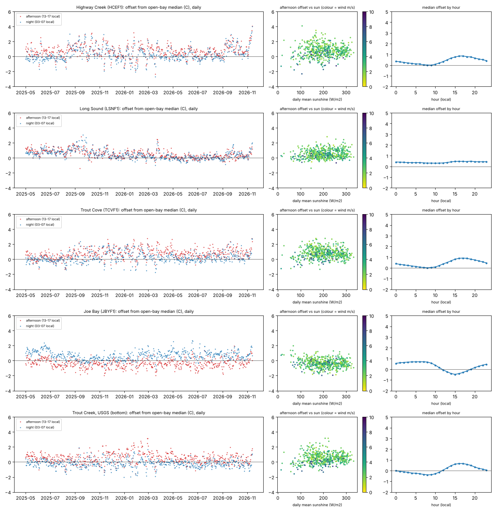

# Northeast Florida Bay: why do Highway Creek, Long Sound and Trout Cove read warm?

Checked 2026-11-14 with 18 months of hourly data (2025-05-01 to 2026-11-14, 555 days).

## Question

In the week of Nov 11, Highway Creek (HCEF1) read about 3.5 C warmer than the stations around it,
and Long Sound (LSNF1) and Trout Cove (TCVF1) about 2 C warmer. Joe Bay (JBYF1) and USGS Trout Creek
(251253080320100, bottom sensor) did not. A sensor problem would show up as an offset that stays the
same in all weather, day and night. Real heating of shallow water would show up as an offset that
peaks on calm, sunny afternoons and fades at night and on windy or cloudy days.

## Data and method

- Water temperature: Everglades National Park stations on SECOORA ERDDAP (provider QC flags 1 and 2
  kept), and USGS Trout Creek from NWIS. Hourly means.
- Reference: each hour, the median of seven open-bay stations in eastern Florida Bay: Manatee Bay,
  Little Blackwater Sound, Blackwater Sound, Duck Key, Middle Key, Thursday Point, Butternut Key.
  The offset is station minus reference.
- Weather: daily mean sunshine from the USDA SCAN station Everglades ARS (near Homestead, about
  30 km north); wind from NOAA CO-OPS Vaca Key.
- "Calm sunny" days are the sunniest third and calmest third together; "cloudy or windy" days are
  the cloudiest third or the windiest third.
- Code: `analysis/pull_florida_bay.py` (download) and `analysis/florida_bay_offsets.py` (analysis).
  Outputs are in `docs/florida_bay/`.

## Results over 18 months

Medians, in C, of the daily offset from the open-bay reference.

| Station | Whole day | Night (3 to 7 am) | Afternoon (1 to 5 pm) | Afternoon, calm sunny days | Afternoon, cloudy or windy days | Monthly median, lowest to highest | Nov 1 to 14, 2026 |
|---|---:|---:|---:|---:|---:|---|---:|
| Highway Creek | +0.40 | +0.14 | +0.70 | +0.80 | +0.58 | +0.05 to +2.11 | +1.96 |
| Long Sound | +0.40 | +0.36 | +0.45 | +0.47 | +0.44 | -0.06 to +1.33 | +0.82 |
| Trout Cove | +0.44 | +0.16 | +0.71 | +0.64 | +0.73 | +0.09 to +1.07 | +0.94 |
| Joe Bay | +0.24 | +0.68 | -0.39 | -0.43 | -0.34 | -0.22 to +1.10 | +0.75 |
| Trout Creek, USGS (bottom) | +0.09 | -0.22 | +0.49 | +0.72 | +0.38 | -0.22 to +0.57 | -0.09 |

Four things stand out.

1. **No station has a fixed offset.** Every station's offset moves from month to month. Long Sound
   was about +1 C in late summer 2025 and close to 0 from May to August 2026. A calibration error
   would not come and go like that.
2. **Highway Creek and Trout Cove normally show real shallow-water heating.** Their median offset
   is near 0 at dawn and climbs to +0.8 or +0.9 C in late afternoon, the same shape as the USGS
   Trout Creek bottom sensor (-0.4 at dawn, +0.7 late afternoon). Long Sound is flat through the
   day (+0.3 to +0.5) and runs warmer when it is fresher than the bay (+0.78 C on days more than
   5 PSU fresher, +0.33 C otherwise), which points to a different water mass rather than sunshine.
   Joe Bay has the opposite daily shape: cooler afternoons, warmer nights.
3. **Day-to-day weather explains little.** Calm sunny afternoons are only slightly warmer than
   cloudy or windy ones (Highway Creek +0.80 against +0.58; USGS Trout Creek +0.72 against +0.38;
   no difference at Trout Cove or Long Sound). A fit on sunshine and wind explains at most 11% of
   the day-to-day variation at any station. Sunny-day heating is real here, but it is worth tenths of
   a degree, not several degrees.
4. **November 2026 is unusual.** Since about Nov 5, every northeast surface station has warmed
   relative to the open bay, and by the same amount day and night. Long Sound went to +2.0, Trout
   Cove to +1.5, Joe Bay to +1.4 (4-day means), while the USGS Trout Creek bottom sensor stayed near 0.
   Because the offset is the same day and night, this is not sunshine heating. It looks like warm
   surface water in the northeast corner, so part of this week's warmth is real. Highway Creek rose
   faster and further: +0.3 (Nov 1 to 4), +1.8, +2.9, then +3.9 (Nov 13 to 14), about twice the
   other stations. That is beyond anything in its 18-month record. Its previous highs were +1.1 to
   +1.4 C as monthly medians, during wet-season freshening in 2025 and September 2026. The November
   rise does not follow its salinity either: September 2026 was fresher, and the offset was smaller.

## What this means

- **Long Sound:** a real difference (water mass), not a sensor fault. It stays in the grids.
- **Trout Cove:** real shallow-water behaviour, plus this month's warm surface water. It stays in
  the grids, as a separate station from USGS Trout Creek. The two are 240 m apart but in different
  water: the cove's surface reads 0.36 C warmer than the creek mouth's bottom as an 18-month median
  (1.2 C this week), and salinity averaged 23.9 against 18.7 PSU over Nov 11 to 14.
- **Highway Creek:** its usual behaviour is real, but the November 2026 excess (about 2 C beyond
  the other northeast stations, the same day and night, growing steadily) fits a developing sensor
  problem such as fouling or drift. A very local warm water source can't be ruled out from the data
  alone. **Its temperature stays held** (`qc_hold` in `config/station_tags.json`), so it is flagged
  suspect and kept out of the grids whatever the neighbor test says.

Suggested next step: ask Everglades National Park, which runs the station, whether HCEF1 has been
serviced recently or shows an instrument fault. Lift the hold after a service visit, or if the
offset settles back below about 1 C for a couple of weeks. Rerun both scripts to check.
